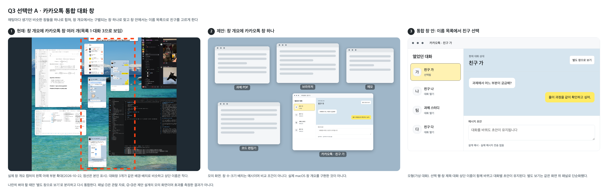

# 문제 3 답안 초안

## 1단계 공감과 관찰

10월 22일 저녁 집에서 Mac으로 과제·공부를 하던 중(학습 현장), 친구에게 과제를 질문하려고 카카오톡 대화로 돌아가는 과정에서 불편을 체험했다. 평소처럼 터치패드에서 네 손가락을 위로 쓸어 창 개요를 열었다. 다른 앱 창들은 내용과 모양이 서로 달라 금방 찾았지만, **카카오톡은 채팅마다 생긴 창들이 같은 배경과 배치로 비슷해 보여 원하는 친구의 창을 바로 찾지 못했다**(그림 1). Dock에서 카카오톡을 열자 창 4개가 한꺼번에 나타났고, 결국 창을 하나씩 닫으며 원하는 친구의 창을 찾았다.

본인 환경에서는 채팅 목록에서 채팅을 누르면 항상 별도 창이 열린다. 목록에서 상대를 고르면 해당 창이 앞으로 오는 기능은 있지만, 불편을 겪을 당시 목록 창은 열려 있었는데도 다른 창들에 가려져 있었다. 창 개요에서 목록 창이 어떻게 보였는지는 확인하지 못했다.

페르소나는 **여러 앱 창을 동시에 띄워 두고 터치패드 창 개요로 전환하며 공부하다가, 친구에게 질문하려고 특정 대화로 돌아가는 Mac 사용자 학생**이다. 본인 1명의 경험에 근거한 과업 중심 페르소나다. 핵심 페인 포인트는 **창 개요에서 비슷한 카카오톡 창들 중 원하는 친구를 바로 고를 수 없었고, 결국 창을 하나씩 닫으며 찾아야 했다는 것**이다. 소요 시간·오선택 횟수는 측정하지 않았다.

## 2단계 문제 정의

선정 문제는 **학습 중 특정 친구의 대화로 돌아가려 할 때, 카카오톡이 채팅마다 비슷한 별도 창을 만들어 목표 상대를 구별·선택해야 하는 부담**이다.

| 원인 | 인간공학적 진단 |
|---|---|
| 유사성 묶음이 과업과 맞지 않음 | 카카오톡 대화창들은 같은 배경색과 배치를 공유해 유사성 원리에 따라 하나의 묶음으로 지각된다(「3장 보충 2026.pdf」 PDF p.71, 101). 묶음은 과업 요구와 맞아야 하는데(같은 자료 PDF p.102), 이 묶음은 카카오톡을 알아보는 데만 맞고 그 안에서 친구 한 명을 고르는 과업과는 맞지 않는다. 묶음 안의 창을 구별하려면 세부를 보는 초점 처리가 필요하다(같은 자료 PDF p.89). |
| 상대 이름 글자가 작음 | 시각은 대상의 크기와 거리로 정해지며 시력은 세부를 식별하는 능력이다(「5장 보충 vision and visual acuity.pdf」 PDF p.9). 썸네일로 줄면 이름 글자의 시각이 작아져 이름으로 구별하기 어려워질 수 있다. 중요한 정보일수록 크게, 따로 보여야 하는데(「6장 디스플레이 보충 2026.pdf」 PDF p.24), 상대를 구별하는 가장 중요한 정보인 이름이 창 상단에 작게 있다. |
| 과업 단위와 창 단위가 다름 | 과업의 단위는 친구 한 명인데 창의 단위는 열어 둔 채팅 하나라서, 열린 채팅이 늘수록 골라야 할 비슷한 창도 늘어난다. 구조화된 탐색에서도 항목의 위치 순서에 따라 찾는 시간이 늘어나는데(「3장 보충 2026.pdf」 PDF p.98), 창 개요에는 이름 순서 같은 안내조차 없어 비슷한 창을 하나씩 확인하게 될 수 있다. |
| 탐색을 안내할 목록이 가려짐 | 메뉴처럼 탐색을 안내할 수 있는 목록 창(같은 자료 PDF p.98)이 Dock으로 돌아간 뒤 다른 창들에 가려져, 겹친 창을 하나씩 닫으며 확인하는 우회 행동으로 이어졌다. |

이 구조는 작업을 사람에게 맞춰야 한다는 원칙(「Lecture 1 인간공학 소개 2026.pdf」 PDF p.25)과 거리가 있다. 화면 거리·글자 크기·탐색 시간·오선택은 측정하지 않았으므로 위 원인은 관찰과 자기보고에 근거한 가설이다.

## 3단계 아이디어 도출

**어떻게 하면 학습 중인 학생이 비슷한 대화창들 사이에서 원하는 친구의 대화를 바로 알아보고 열 수 있을까?**

원인별로 대안을 하나 이상 낸 뒤 효과·실현 가능성·새 부담으로 비교했다.

| 대안 | 대응하는 원인·인지적 한계 | 새 부담과 한계 |
|---|---|---|
| A 통합 대화 창 | 창 개요에 비슷한 창 여러 개가 아니라 구별되는 창 하나가 나타나고(유사성·과업 단위), 창 안에서는 항상 보이는 대화 목록에서 이름으로 고른다(탐색 안내). | 창 구조를 바꿔야 하고, 목표가 마지막 대화와 다르면 한 번 더 골라야 하며, 기존 습관이 바뀐다. |
| B 대화창 상단 대화목록 버튼 | 가려진 목록을 앞으로 가져온다(탐색 안내의 가림). | 목록 선택은 이미 있는 기능이고, 창 개요 단계와 창이 쌓이는 구조는 그대로다. |
| C 개별 창 식별 강화 | 창 상단에 큰 상대 이름을 두어 썸네일에서도 읽히게 한다(유사성·작은 글자). | 창이 여러 개인 구조가 남고 썸네일 축소율에 따라 한계가 있다. |
| D 기존 목록 경로 안내 | 목록에서 고르는 기존 기능을 알린다(기억 의존·발견 가능성). | 창 개요 단계와 가림 문제는 그대로다. |

**A를 프로토타입으로 선택하고 C를 보조안으로 둔다.** 불편이 시작된 창 개요 단계에서 카카오톡이 구별되는 창 하나로 나타나고, 그 안에서는 이름 목록으로 고르게 하기 때문이다. 왼쪽 목록이 항상 보이므로 B가 다루던 가림 문제도 함께 해결된다. 본인 환경에는 한 창에서 대화를 여는 기능이 없다. 이 선택은 설계 판단이며 실험으로 확인한 결과는 아니다.

## 4단계 프로토타입

카카오톡 데스크톱의 **통합 대화 창**을 제안한다.

1. 기본은 통합 창 하나다. 왼쪽에 기존 대화 목록(검색 포함)을 그대로 두고 오른쪽에 선택한 대화를 둔다. 목록에서 대화를 열어도 새 창을 만들지 않으므로 창 개요에서 카카오톡은 구별되는 창 하나로 나타난다.
2. 창 제목과 대화 상단에 현재 상대 이름을 크게 표시하고, 목록의 선택 행은 테두리·배경과 '선택됨' 문자로 표시한다. 선택 표시와 상단 이름을 대조해 맞는 상대인지 판단하는 일은 함께 처리하는 비교 판단이므로 둘을 한 창 안에 가까이 둔다(「6장 디스플레이 보충 2026.pdf」 PDF p.32의 근접 부합성). 고른 결과를 바로 확인하게 해 평가차를 줄이려는 설계다(「8장 콘트롤 보충.pdf」 PDF p.4).
3. 대화를 바꿔도 대화별 초안과 읽던 위치를 유지한다.
4. 여러 대화를 나란히 봐야 할 때만 '별도 창으로 보기'로 분리하고 '통합 창으로 복귀'로 되돌린다. 분리한 창이 늘면 원래 문제가 다시 생기므로, 분리한 창에는 큰 상대 이름(C)을 적용한다. 채팅마다 창을 여는 기존 방식은 설정으로 남겨 습관 변화의 부담을 줄인다.

모형은 통합 창 안의 대화 선택, 이름·선택 표시, 대화별 초안 유지를 구현했고, 별도 보기는 같은 화면 위 패널로 단순화했다. 그림 2의 ②는 모의 화면이며, 실제 카카오톡이나 macOS의 창 개요·Dock 동작을 구현한 것은 아니다.

## 5단계 테스트 계획

테스트는 미수행이다. 창 개요에서 시작해 지시받은 친구의 대화를 열고 이름을 확인하는 과업으로, 기존 구조(채팅마다 창)와 통합 창을 같은 충실도의 모형으로 비교한다. 목표가 마지막 대화인 경우와 다른 대화인 경우를 모두 포함하고, 열린 채팅 수·다른 앱 창 수·목록 창 상태를 같게 두며, 참가자 간 비교나 조건 순서 상쇄로 학습 효과를 줄인다. 완료 여부·전체 시간·오선택을 보고, 설계 의도를 아는 본인은 첫 사용 측정 대상에서 제외한다(「2장 보충 인간공학 연구방법론.pdf」 PDF p.22-23, 32).
